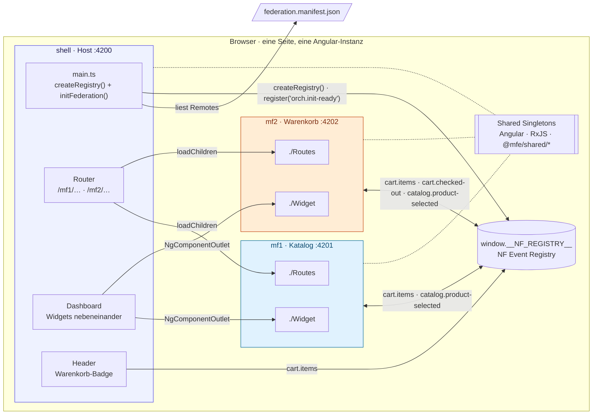
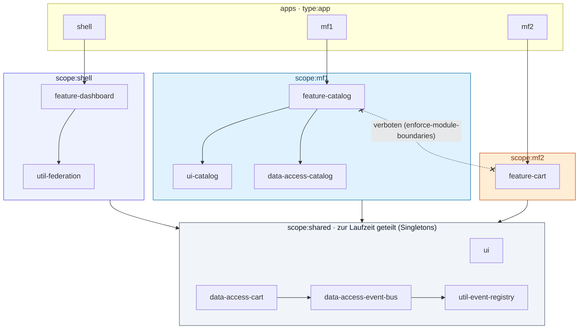
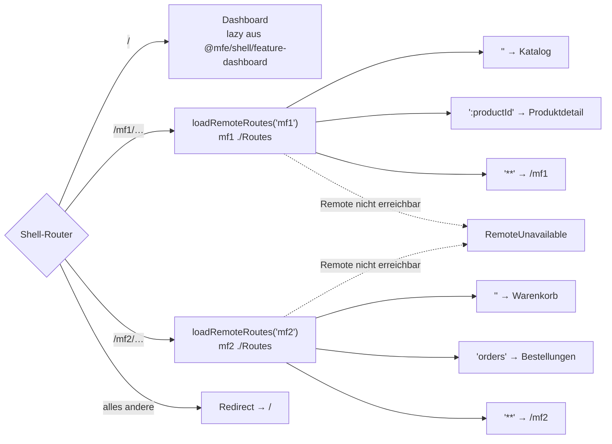
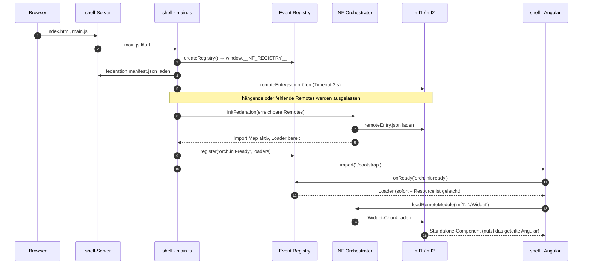
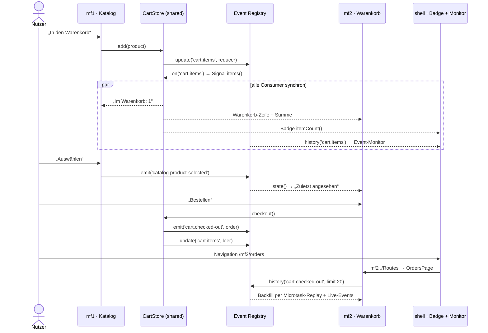
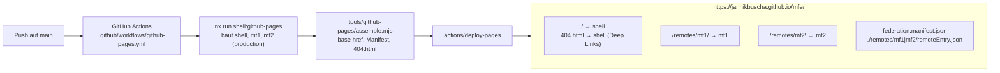

# MFE – Nx 24 · Angular 22 · Native Federation

Ein Nx-Monorepo mit drei Angular-22-Anwendungen:

| App     | Rolle                                    | Port |
| ------- | ---------------------------------------- | ---- |
| `shell` | Host (dynamic host, lädt die Remotes)    | 4200 |
| `mf1`   | Remote „Katalog“ (Produkte)              | 4201 |
| `mf2`   | Remote „Warenkorb“ (Cart & Bestellungen) | 4202 |

Die Micro Frontends werden per **Native Federation** (`@angular-architects/native-federation` 22.2 mit dem Orchestrator `@softarc/native-federation-orchestrator` 4.8) eingebunden und kommunizieren ausschließlich über die **NF Event Registry** (`window.__NF_REGISTRY__`). Sie importieren sich nie gegenseitig.

Die Shell zeigt beide MFs

- **nebeneinander** auf dem Dashboard (`/`) – jedes Remote liefert dafür ein `./Widget` (auf schmalen Bildschirmen untereinander), und
- **über den Router** (`/mf1`, `/mf1/:productId`, `/mf2`, `/mf2/orders`) – jedes Remote liefert dafür seine `./Routes`.

**Live-Demo:** https://jannikbuscha.github.io/mfe/ (siehe [GitHub Pages](#github-pages))

### Architektur



Die Shell lädt beide Remotes über das Manifest, rendert ihre `./Widget`s auf dem Dashboard und hängt ihre `./Routes` in den eigenen Router. Angular, RxJS und die `@mfe/shared/*`-Libraries existieren nur einmal; alles, was zwischen den Micro Frontends fließt, geht über die Registry.

## Schnellstart

Voraussetzung: **Node.js ≥ 24.16** (siehe `.nvmrc`; Angular 22 verlangt `^22.22.3 || ^24.15`, der NF-Orchestrator `>=24.16`).

```bash
npm ci
npm start            # = nx run-many -t serve -p shell,mf1,mf2
```

Dann http://localhost:4200 öffnen.

Einzeln starten:

```bash
npx nx serve mf1     # Remote standalone: http://localhost:4201
npx nx serve mf2     # Remote standalone: http://localhost:4202
npx nx serve shell   # Host:              http://localhost:4200
```

Jedes Remote läuft auch **standalone**: Seine `main.ts` legt dann eine eigene Registry an, und die App nutzt dieselben `./Routes` wie die Shell.

Weitere Befehle:

```bash
npm run build        # nx run-many -t build
npm test             # nx run-many -t test   (Vitest)
npm run lint         # nx run-many -t lint   (inkl. Module Boundaries)
npm run e2e          # nx e2e shell-e2e      (Playwright, startet alle drei Apps)
npx nx graph         # Projekt-Graph
```

Die E2E-Tests starten lokal die Dev-Server (laufende Server, z. B. von `npm start`, werden wiederverwendet). Mit `CI=true` werden stattdessen die Production-Builds gebaut und per `serve-static` ausgeliefert, sodass die echten Federation-Artefakte getestet werden.

Im Dev-Modus meldet Chromium bei jedem Laden `Invalid asm.js: Unexpected token`. Das ist eine harmlose Warnung aus dem Lexer von `es-module-shims` (Native Federation läuft im Shim-Modus); Production-Builds zeigen sie nicht.

## Workspace-Struktur

```
apps/
  shell/                 Host: Layout, Navigation, Routen, main.ts (Registry + initFederation)
  shell-e2e/             Playwright-Tests gegen Shell + beide Remotes
  mf1/                   Remote „Katalog“, exposes ./Routes und ./Widget (src/app/remote-entry)
  mf2/                   Remote „Warenkorb“, exposes ./Routes und ./Widget (src/app/remote-entry)
libs/
  shared/
    util-event-registry/    Event-Contract (MfeEvents, MfeResources) + typisierter Zugriff auf window.__NF_REGISTRY__
    data-access-event-bus/  Angular-Fassade: EventBus (Signals, Observable, auto-unsubscribe)
    data-access-cart/       CartStore auf dem State-Channel cart.items
    ui/                     Panel, EventLog, EuroPipe
  shell/
    feature-dashboard/      Dashboard: beide Remote-Widgets nebeneinander + Event-Monitor
    util-federation/        loadRemoteRoutes / loadRemoteWidget über orch.init-ready
  mf1/
    feature-catalog/        Katalog-Seite, Produktdetail, Widget
    data-access-catalog/    Produktdaten
    ui-catalog/             ProductCard
  mf2/
    feature-cart/           Warenkorb-Seite, Bestellungen, Widget
```

### Nx-Konventionen

Libraries folgen dem üblichen Nx-Schema `libs/<scope>/<type>[-<name>]` mit Tags, die `@nx/enforce-module-boundaries` (siehe `eslint.config.mjs`) durchsetzt:

| Tag                | darf abhängen von                      |
| ------------------ | -------------------------------------- |
| `scope:shell`      | `scope:shell`, `scope:shared`          |
| `scope:mf1`        | `scope:mf1`, `scope:shared`            |
| `scope:mf2`        | `scope:mf2`, `scope:shared`            |
| `scope:shared`     | `scope:shared`                         |
| `type:app`         | `feature`, `ui`, `data-access`, `util` |
| `type:feature`     | `feature`, `ui`, `data-access`, `util` |
| `type:ui`          | `ui`, `util`                           |
| `type:data-access` | `data-access`, `util`                  |
| `type:util`        | `util`                                 |

(`shell-e2e` trägt `scope:shell, type:e2e` und importiert keine Libraries.)

Abhängigkeiten der Projekte (vereinfacht, aus `npx nx graph`):



Damit kann MF1 technisch nicht auf Code von MF2 (oder der Shell) zugreifen. Gemeinsam nutzen die Micro Frontends nur `scope:shared`-Code: den Event-Contract, zustandslose Fassaden über die Registry (`EventBus`, `CartStore`) und UI-Bausteine. Kommuniziert wird ausschließlich über die Registry.

## Native Federation

- Die Projekte wurden mit `nx g @angular-architects/native-federation:init` eingerichtet (Shell als `dynamic-host`, MFs als `remote`). Das Target `build`/`serve` nutzt den NF-Builder, das ursprüngliche Angular-Build liegt in `esbuild`/`serve-original`.
- Die Shell lädt die Remotes zur Laufzeit aus `apps/shell/public/federation.manifest.json`. Die Datei landet ungehasht in `dist/apps/shell/browser/`; beim Deployment dort die Remote-URLs eintragen (oder relative URLs hinter einem Reverse Proxy nutzen). Liegen Remotes auf einer anderen Origin, müssen sie `remoteEntry.json` und ihre JS-Dateien mit `Access-Control-Allow-Origin` ausliefern (die NF-Dev-Server und `serve-static` tun das).
- Remotes exponieren (siehe `apps/mf*/federation.config.mjs`):
  - `./Routes` → `src/app/remote-entry/entry.routes.ts` (`export default` Routes)
  - `./Widget` → `src/app/remote-entry/widget.ts` (`export default` Standalone-Component)
- Geteilt werden Angular, RxJS und – per `sharedMappings: mappingsFromWorkspace().filter(['@mfe/shared/*'])` – nur die `scope:shared`-Libraries (Singletons). App-spezifische Libraries werden ins jeweilige Bundle gebaut.
- Shell und Remotes teilen sich **eine** Angular-, RxJS- und `@mfe/shared`-Instanz. Ändern sich Angular-Version oder `@mfe/shared`, müssen alle drei Apps gemeinsam gebaut und ausgeliefert werden (`nx affected` baut dann ohnehin alle). Payloads auf der Registry sollten abwärtskompatibel bleiben – oder unter neuem Event-Namen erscheinen.
- `@angular/platform-browser/animations*` steht auf der `skip`-Liste, weil `@angular/animations` nicht installiert ist.

### Routing

Die Shell hängt die `./Routes` der Remotes unter `/mf1` bzw. `/mf2` ein; Links innerhalb der Remotes sind relativ, deshalb funktionieren dieselben Routen auch standalone unter `/`.



## NF Event Registry

### Erzeugung (Option B: eigener Orchestrator-Host)

`apps/shell/src/main.ts` legt die Registry an, **bevor** irgendein Consumer-Code läuft, und veröffentlicht danach die Loader des Orchestrators als Resource `orch.init-ready`:

```ts
window.__NF_REGISTRY__ ??= Object.freeze(
  createRegistry({ maxEvents: 50, maxStreams: 50, removePercentage: 0.5 })(),
);

reachableRemotes('federation.manifest.json')
  .catch(() => ({})) // ohne Manifest startet die Shell ohne Remotes
  .then((remotes) =>
    initFederation(remotes, { hostRemoteEntry: { url: './remoteEntry.json' } }),
  )
  .then((federation) =>
    window.__NF_REGISTRY__?.register('orch.init-ready', { ...federation }),
  )
  .then(() => import('./bootstrap'));
```

`main.ts` importiert zur Laufzeit weder Angular noch `@mfe/*`-Libraries: Diese werden über die Import Map geteilt, die erst nach `initFederation()` existiert.

`reachableRemotes()` (`apps/shell/src/reachable-remotes.ts`) lädt das Manifest selbst und übergibt nur Remotes, deren `remoteEntry.json` innerhalb von 3 s antwortet. `initFederation()` wartet sonst ohne Timeout auf jedes Remote – ein hängendes Remote würde die ganze Shell blockieren. Fehlende Remotes landen in den Fallbacks der Shell („… ist nicht erreichbar“ im Dashboard bzw. als Route).

Ablauf beim Start der Shell:



Die Shell lädt Remotes nicht über das (deprecated) globale `loadRemoteModule`, sondern holt sich die Loader per `onReady('orch.init-ready', …)` aus der Registry (`@mfe/shell/util-federation`). Da Resources „latchen“, gibt es kein Race mit `initFederation`.

### Event-Contract

Definiert in `libs/shared/util-event-registry/src/lib/contracts.ts` (alle Payloads `readonly`: Live-Events erreichen jeden Subscriber als dasselbe Objekt):

| Typ                        | Art                                                | Producer  | Consumer                                                             |
| -------------------------- | -------------------------------------------------- | --------- | -------------------------------------------------------------------- |
| `orch.init-ready`          | Resource (`register` / `onReady`)                  | `main.ts` | Shell (Remote-Loader)                                                |
| `cart.items`               | State-Channel (`update`, replay 1)                 | MF1, MF2  | MF1 (Mengen), MF2 (Warenkorb), Shell (Badge), Monitor                |
| `cart.checked-out`         | Event-Log (`emit`, replay N)                       | MF2       | MF2 (Bestellungen, Backfill 20), Monitor                             |
| `catalog.product-selected` | Event (`emit`); Widgets replay 1, Monitor replay N | MF1       | MF1 (aktiver „Auswählen“-Button), MF2 („Zuletzt angesehen“), Monitor |

Ablauf, wenn Nutzer:innen etwas in den Warenkorb legen, ein Produkt auswählen und bestellen:



So zeigt sich das Verhalten der Registry in der Demo:

- **Replay für Late Joiner:** `/mf1/cappuccino` öffnen und dann zum Dashboard wechseln. Das MF2-Widget entsteht erst jetzt und zeigt trotzdem „Zuletzt angesehen: Cappuccino“ – es bekommt das letzte `catalog.product-selected` per Replay.
- **Backfill:** Die Bestellübersicht `/mf2/orders` zeigt auch Bestellungen, die vor dem Öffnen der Seite (z. B. im Dashboard-Widget) aufgegeben wurden.
- **Gemeinsamer State:** Der Warenkorb lebt im State-Channel `cart.items`. In der Shell teilen sich alle MFs eine `CartStore`-Instanz (die Library ist ein Shared Singleton), die schon beim Start der Shell abonniert; standalone hat jedes Remote seinen eigenen `CartStore` und seine eigene Registry.

Die Registry behält mit dieser Konfiguration mindestens 25 Events pro Stream (`maxEvents` 50, Batch-Eviction mit `removePercentage` 0.5). Backfill-Limits (20) müssen darunter bleiben.

### Angular-Integration

`EventBus` (`@mfe/shared/data-access-event-bus`) kapselt die Registry für Angular:

```ts
private readonly bus = inject(EventBus);

readonly cart = this.bus.state('cart.items');                          // Signal, replay 1
readonly orders = this.bus.history('cart.checked-out', { limit: 20 }); // Signal, Backfill
this.bus.update('cart.items', (items = []) => [...items, item]);
this.bus.emit('catalog.product-selected', { productId, name });
this.bus.on$('cart.checked-out', { replay: 0 }).subscribe(...);       // Observable
```

Abos enden automatisch mit der Komponente/dem Service (`DestroyRef`). Die Registry liefert ihr Replay per Microtask; Events, die davor live ankommen, würden sonst doppelt bzw. in falscher Reihenfolge erscheinen – `state()` und `history()` gleichen das aus. In Tests wird statt `window.__NF_REGISTRY__` per `EVENT_REGISTRY`-Token eine eigene `createRegistry()`-Instanz injiziert.

## GitHub Pages

Der Workflow `.github/workflows/github-pages.yml` veröffentlicht Shell und Remotes als **eine** statische Seite unter https://jannikbuscha.github.io/mfe/:



- `nx run shell:github-pages --base-path=/mfe` baut alle drei Apps (production) und ruft `tools/github-pages/assemble.mjs` auf. Das Skript setzt die `<base href>`, schreibt ein Manifest mit relativen URLs (`./remotes/mf1/remoteEntry.json`), kopiert `index.html` nach `404.html` (Deep Links wie `/mfe/mf1/espresso`) und legt die Remotes unter `/remotes/` ab, damit sie nicht mit den Shell-Routen `/mf1` und `/mf2` kollidieren.
- Die Remotes sind dort auch standalone erreichbar: https://jannikbuscha.github.io/mfe/remotes/mf1/ und https://jannikbuscha.github.io/mfe/remotes/mf2/ (Deep Links funktionieren auf Pages nur für die Shell).
- Pull Requests bauen die Seite nur; deployt wird bei jedem Push auf `main` (oder manuell per „Run workflow“).
- Einmalig im Repository einstellen: **Settings → Pages → Source: GitHub Actions**.

Lokal ausprobieren:

```bash
npx nx run shell:github-pages --base-path=/mfe   # → dist/github-pages
```

## Ein weiteres Remote hinzufügen

1. `npx nx g @nx/angular:application --directory=apps/mf3 --name=mf3 --prefix=mf3 --bundler=esbuild --style=scss --e2eTestRunner=none --tags=scope:mf3,type:app`
2. `npx nx g @angular-architects/native-federation:init --project=mf3 --port=4203 --type=remote`
3. `main.ts`, `federation.config.mjs` und `project.json` wie bei `mf1` anpassen (Registry, `./Routes`, `./Widget`, `sharedMappings`, `skip`, `continuous`/`inputs` der NF-Targets, `buildTarget` des `test`-Targets).
4. Shell: Eintrag in `apps/shell/public/federation.manifest.json`, `RemoteName` in `@mfe/shell/util-federation` erweitern, Route in `apps/shell/src/app/app.routes.ts` und Navigation ergänzen, für das Dashboard ein `<ui-panel>` mit `<shell-remote-widget remote="mf3" />` in `libs/shell/feature-dashboard/src/lib/dashboard/dashboard.html` (ggf. `PanelAccent` erweitern).
5. `scope:mf3`-Regel in `eslint.config.mjs` ergänzen, ggf. neue Events in `contracts.ts` definieren und einen `webServer`-Eintrag in `apps/shell-e2e/playwright.config.mts` hinzufügen.
